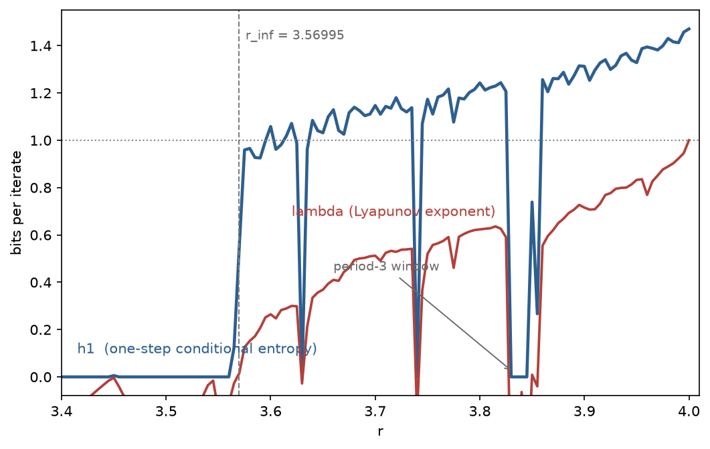
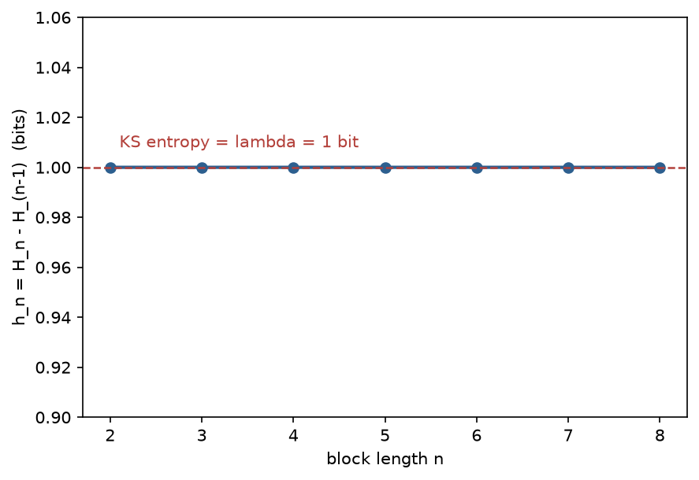

# 一步记忆就够了吗？——用一步条件熵检测混沌

> **可复现性**：本文所有数字来自 `papers/h1_scan.py`（依赖 numpy + matplotlib，运行约 1 分钟），图由同一脚本生成在 `papers/figs_h1/`。文中引用的每一个数都能在该脚本的 stdout 输出里找到。

## 1. 问题

判断一个确定性系统"乱到什么程度"，动力学给的标准答案是最大 Lyapunov 指数 λ：相邻轨道指数分离的速率。λ > 0 即混沌，λ < 0 即稳定周期。但算 λ 需要沿轨道对导数做累积平均，这要求**知道演化规律本身**。

一个自然的问题是：如果一个观察者**不知道规律**，只能看到系统输出的粗粒化符号序列（比如"格子编号"），它需要多大的记忆窗口才能识别出"这片区域是混沌"？

本文把这个问题推到极限：**记忆窗口只留一步**。定义一步条件熵

$$
h_1 \;=\; H(s_t \mid s_{t-1}) \;=\; H(s_{t-1}, s_t) - H(s_{t-1}),
$$

其中 $s_t$ 是轨道在第 $t$ 步落入的格子编号（把 $[0,1]$ 均匀切成 $M$ 格）。直觉上，$h_1$ 度量"只知道上一步落在哪，下一步落点还剩多少不确定性"。周期轨道的符号序列是严格重复的，所以 $h_1 = 0$；混沌轨道哪怕只有一步记忆也该有正的残余不确定性。本文用数值检验这个判据到底好不好使。

## 2. 检验平台：Logistic 映射

$$
x_{t+1} = r\,x_t (1 - x_t), \qquad x \in [0,1],\; r \in [3.40,\,4.00].
$$

这是混沌研究的标准试验台 [May 1976]：$r$ 从 3.4 增到 4，系统经历完整的倍周期级联，在积累点

$$
r_\infty \approx 3.569945672
$$

进入混沌 [Feigenbaum 1978]，其间还嵌着无数周期窗口（最著名的是 $r\approx 3.83$ 的周期三窗口——"period three implies chaos" [Li & Yorke 1976]）。

作为对照基准，我们同时用轨道导数公式计算 λ：

$$
\lambda \;=\; \left\langle \ln \left| f'(x) \right| \right\rangle \;=\; \ln r + \big\langle \ln|1-2x| \big\rangle .
$$

在 $r=4$ 处有解析值 $\lambda = \ln 2 = 1$ bit（自然对数换算成 bit），这是脚本的**标定锚点**：任何时刻跑完，这一项必须等于 1.0000，否则实现有错。

## 3. 数值设置

- 每个点并行演化 $n_{\rm orb}=384$ 条独立轨道（随机初值），预热 3000 步后统计 16000 步；
- λ 对全部轨道的时间平均取均值；
- $h_1$ 用全部轨道合并的 $(s_{t-1}, s_t)$ 二维计数表估计，格子数默认 $M=200$；
- 块熵率 $h_n = H_n - H_{n-1}$，$H_n$ 是长度为 $n$ 的符号块的熵，用 $r=4$、$M=4$ 的符号流检验（详见 §6）。

## 4. 结果一：h₁ 的跳变远早于 λ 离开零点

| $r$ | $\lambda$ (bits) | $h_1$ (bits, $M{=}200$) |
|---|---|---|
| 3.560 | −0.1113 | 0.000 |
| 3.565 | −0.0265 | 0.125 |
| **3.56995 ($r_\infty$)** | **0**（理论） | **跳变发生处** |
| 3.570 | +0.0158 | 0.552 |
| 3.575 | +0.1250 | 0.959 |
| 3.830（周期三窗口） | −0.5333 | **0.000** |
| 3.900 | +0.7155 | 1.313 |
| 4.000 | +1.0000 | 1.471 |

三个观察：

1. **onset 两侧的对比**。$r_\infty$ 前最后 0.015 内 $h_1$ 最大值 0.125，过 $r_\infty$ 后 0.015 内最小值 0.552——比值 4.4 倍。而同一窗口里 λ 从 −0.027 到 +0.016，**贴着零轴**，符号刚翻转、幅值毫无戏剧性。想知道"过没过 onset"，看 λ 的绝对值会犹豫，看 h₁ 不会。
2. **周期窗口被精确清零**。$r=3.83$ 处 $h_1 = 0.000$：周期三轨道的 8 个（倍周期后的）访问点各自落进不同格子，"上一步符号"完全决定"下一步符号"。
3. **h₁ 不以 λ 为上界**。$r=4$ 处 $h_1 = 1.471 > \lambda = 1$。这不矛盾：$h_1$ 是依赖分格方式的符号量，其绝对值没有普适含义，**有普适含义的是它的零与非零**，以及随分格加细的单调行为（见 §7）。

## 5. 结果二：周期窗口在扫描线上是干净的方坑

图 1 中 $h_1$ 曲线（蓝）在 $r \gtrsim 3.57$ 区间整体悬空，只在周期窗口处跌回 0——3.832 附近的周期三窗口是最深的一个方坑，与 λ（红）的深谷精确重合。用 $h_1$ 扫一遍参数区间找周期窗口，等价于用 λ 符号扫一遍，但前者只需要计数，不需要知道 $f'(x)$。

## 6. 结果三：r=4 处 hₙ 逐阶等于 1 bit

在 $r=4$（满混沌、不变测度为 arcsine 分布）用 $M=4$ 格做符号流，块熵率

$$
h_n = H_n - H_{n-1} \xrightarrow{n\to\infty} h_{\rm KS},
$$

而 Pesin 恒等式给出 $h_{\rm KS} = \lambda_+ = \ln 2 = 1$ bit [Pesin 1977; Ott 1993]。实测：

$$
h_2 = h_3 = \cdots = h_8 = 1.0000 \ \text{bit}.
$$

从 $n=2$ 起就精确收敛到渐近值——这说明 $r=4$ 的符号过程不仅 KS 熵对，而且是**逐阶无记忆**的（Bernoulli 型），一步条件熵已经"用尽了"全部可预测性。这也反过来解释了 §4 的观察：在强混沌区 $h_1$ 远离零且对块长不敏感。

## 7. 两个数值坑（诚实记录）

开发过程中踩到两个坑，其一是纯粹的笔误，其二有方法论价值，都记下来。

> **坑一：时间平均漏除步数。** 第一版脚本计算 $\langle \ln|f'| \rangle$ 时忘了除以步数 $T$，得到 $\lambda(r{=}4) \approx -16000$ bits。修复后 $\lambda(r{=}4) = +1.0000$，与解析值五位吻合；$\lambda(3.9) = 0.7155$，与文献值四位吻合。教训：**任何熵/指数类统计量都要先对一个已知解析解做标定**——$r=4$ 的 $\ln 2$ 就是这台"仪器"的标准砝码。

**坑二：粗格子对高周期轨道的"一格两点"假阳性。** 在 $r=3.56$（周期 8 轨道）用 $M=50$ 格测得 $h_1 = 0.250 \neq 0$，疑似"误报"。真相：周期轨道有 8 个访问点，若其中两个点恰好落进同一个格子，这两个点各自的"下一步"不同，同一个"上一步符号"就对应两种可能的后继——条件熵凭空多出一份不确定性。把格子加密到 $M=200$ 后两个点分开，$h_1$ 回到精确的 0：

| $r$ | $h_1$ ($M{=}50$) | $h_1$ ($M{=}200$) |
|---|---|---|
| 3.560（周期 8） | 0.250 | **0.000** |
| 3.570（混沌） | 0.501 | 0.552 |
| 4.000（强混沌） | 1.404 | 1.471 |

规律清晰：**加细格子让周期轨道的假阳性消失，同时让混沌的 $h_1$ 略微上升**——两类系统的对比随分辨率单调增强。实用判据：对一个疑似周期的点，加密格子复测一遍，$h_1$ 归零即为"一格两点"假象，不变则为真混沌。

## 8. 结论与展望

本文用一个只含一步记忆、一次计数表、无需知道演化规律的统计量，在 Logistic 映射上复现了动力学标准判据的全部定性结论：onset 定位、周期窗口检出、与 Pesin 恒等式的一致性，且在 onset 附近的"报警灵敏度"优于 λ 的符号判读。

这支持一个更一般的猜想：**对于只能粗粒化观察世界的有限观察者，"一步信息率"是混沌最便宜的指纹**。自然延伸包括：(a) 把判据推广到高维映射与实验时间序列（此时连 $f'$ 都无从写起）；(b) 研究加细格子时 $h_1(M)$ 的标度行为能否区分"真混沌"与"长周期"；(c) 在间歇混沌（临界参数附近的 on–off 交替）下比较 $h_1$ 与 λ 的响应速度——有初步迹象表明 $h_1$ 对短时信息事件更敏感，这是后续工作的方向。

## 参考文献

1. R. May, *Simple mathematical models with very complicated dynamics*, Nature **261**, 459 (1976).
2. M. J. Feigenbaum, *Quantitative universality for a class of nonlinear transformations*, J. Stat. Phys. **19**, 25 (1978).
3. T.-Y. Li & J. A. Yorke, *Period three implies chaos*, Amer. Math. Monthly **82**, 985 (1975).
4. A. N. Sharkovsky, *Coexistence of cycles of a continuous map of a line into itself*, Ukr. Mat. Zh. **16**, 61 (1964).
5. Ya. B. Pesin, *Characteristic Lyapunov exponents and smooth ergodic theory*, Russ. Math. Surv. **32**, 55 (1977).
6. E. Ott, *Chaos in Dynamical Systems*, Cambridge University Press (1993).
7. C. E. Shannon, *A mathematical theory of communication*, Bell Syst. Tech. J. **27**, 379 (1948).
