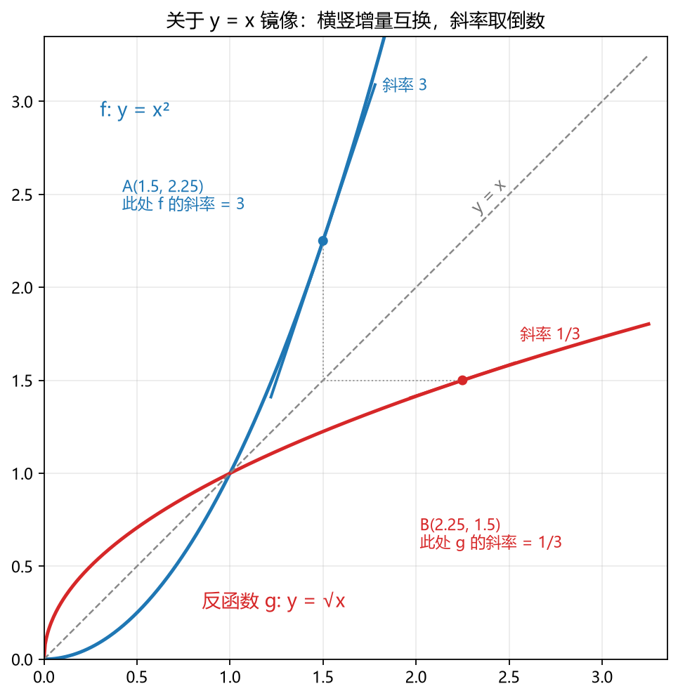

# 反函数求导讲义——为什么斜率取倒数

> **说明**：这是讲义，不是论文——目标是把反函数求导这条公式讲透：变量为什么总记混、公式为什么长这样、哪里最容易翻车。配图由 `papers/inverse_slope_fig.py`（numpy + matplotlib）生成在 `papers/figs_inverse/`，可复现。

## 1. 混淆的根源：每个符号住在哪个世界

反函数求导只有一条公式，但里面的字母住在不同的「世界」里。设 $f$ 把 $x$ 轴上的点映到 $y$ 轴，$g$ 是它的反函数（$g=f^{-1}$）。先列住址表：

| 符号 | 是什么 | 自变量住在哪 | 在哪儿求值 |
|---|---|---|---|
| $f$ | 原函数 | $x$ 世界 | $f(x)$ |
| $f'(x)$ | $f$ 的导数 | $x$ 世界 | 点 $x$ |
| $g$ | 反函数 | $y$ 世界 | $g(y)$ |
| $g'(y)$ | $g$ 的导数 | $y$ 世界 | 点 $y$ |
| $g\circ f$ | 复合（先 $f$ 后 $g$） | $x$ 世界 | 化简后恒等于 $x$ |

一条约定：**本讲义从不写 $g'(x)$**。反函数的自变量天然住在 $y$ 世界，写成 $g'(y)$ 才不会串门。教科书把两边都写成 $x$，正是变量混淆的最大来源。

## 2. 结论先行

同一条公式有两种「住址」写法。$x$ 世界形式：

$$
g'\big(f(x)\big)=\frac{1}{f'(x)}
$$

（左边 $g'$ 的自变量是 $f(x)$，住在 $y$ 世界；要求 $f'(x)\neq 0$。）

令 $y=f(x)$（即 $x=g(y)$），得到完全在 $y$ 世界叙述的：

$$
g'(y)=\frac{1}{f'\big(g(y)\big)}
$$

两式是同一句话，只是求值点换了世界。下面先看它为什么「该」是这样，再证它确实是这样。

## 3. 直观版：镜像把横竖增量互换

图 1 里有两件事值得盯住：

1. 红曲线（反函数）是蓝曲线关于直线 $y=x$ 的**镜像**——反函数的几何定义就是「把图像沿 $y=x$ 翻转」：原图像上的点 $(x,\,y)$ 翻转后落在 $(y,\,x)$。
2. 蓝曲线在 $A(1.5,\,2.25)$ 处斜率是 $3$（因为 $f'(x)=2x$），镜像点 $B(2.25,\,1.5)$ 处红曲线斜率恰好是 $\tfrac13$（因为 $g'(y)=\tfrac{1}{2\sqrt{y}}$，代 $y=2.25$ 得 $\tfrac13$）。

为什么镜像必然让斜率取倒数？因为**反射把水平增量和竖直增量交换**。原图像在 $A$ 附近「横走 $\Delta x$、竖走 $\Delta y$」，翻转后同一对点变成「横走 $\Delta y$、竖走 $\Delta x$」——分子分母正好互换：

$$
f'(x)=\lim_{\Delta x\to 0}\frac{\Delta y}{\Delta x},
\qquad
g'(y)=\lim_{\Delta y\to 0}\frac{\Delta x}{\Delta y}
$$

而取极限之前就有恒等式

$$
\frac{\Delta x}{\Delta y}=\frac{1}{\Delta y/\Delta x}
$$

（分母极限非零时，「倒数的极限 = 极限的倒数」。）用切线倾角说：反射把倾角 $\alpha$ 变成 $90^\circ-\alpha$，而

$$
\tan(90^\circ-\alpha)=\frac{1}{\tan\alpha}
$$

这就是「斜率 3 ↔ 斜率 1/3」的全部几何内容。

## 4. 严谨版：链式法则，三行证完

反函数的定义是一条恒等式：对定义域内一切 $x$，

$$
g\big(f(x)\big)=x
$$

两边对 $x$ 求导。右边导数是 $1$；左边是复合函数，用链式法则：

$$
g'\big(f(x)\big)\cdot f'(x)=1
$$

只要 $f'(x)\neq 0$，两边除一下：

$$
g'\big(f(x)\big)=\frac{1}{f'(x)}
$$

证毕。这个证明还顺带回答了「条件 $f'\neq 0$ 从哪来」：若某点 $f'(x_0)=0$，上式就成了 $0=1$——所以**反函数可导的地方，原函数导数必然非零**。这不是附加假设，而是恒等式逼出来的。

把它翻译回 $y$ 世界：令 $y=f(x)$，即 $x=g(y)$，代入得

$$
g'(y)=\frac{1}{f'\big(g(y)\big)}
$$

## 5. Leibniz 记号：这里真的可以「上下颠倒」

把两版导数写成微分记号：

$$
\frac{dy}{dx}\quad\xrightarrow{\;\text{换成反函数视角}\;}\quad\frac{dx}{dy}=\frac{1}{\;dy/dx\;}
$$

在反函数这一场合，$\dfrac{dx}{dy}$ 确实可以当分数直接倒过来用。这不是记号的运气——它的严格性由第 4 节的链式法则兜底，直观性由第 3 节的「横竖互换」兜底。Leibniz 记号「像分数就当分数用」的合法场合不多，这里是其中之一。

## 6. 现场演示：三个导数不用背

住址表列清楚后，一批「背诵条目」退化成三行推导。

**arcsin。** $g(y)=\arcsin y$ 的反函数是 $f(x)=\sin x$，$f'(x)=\cos x$，故

$$
g'(y)=\frac{1}{\cos\big(\arcsin y\big)}
$$

画一个直角三角形：设 $\theta=\arcsin y$，则对边为 $y$、斜边为 $1$，勾股给出邻边 $\sqrt{1-y^2}$；$\arcsin$ 的值域限制保证 $\cos\theta\ge 0$，所以

$$
(\arcsin y)'=\frac{1}{\sqrt{1-y^2}}
$$

**ln。** $g(y)=\ln y$ 的反函数是 $f(x)=\mathrm{e}^x$，$f'=\mathrm{e}^x$，故

$$
(\ln y)'=\frac{1}{\mathrm{e}^{\ln y}}=\frac{1}{y}
$$

**arctan。** $f(x)=\tan x$，$f'=\sec^2 x=1+\tan^2 x$，故

$$
(\arctan y)'=\frac{1}{1+\tan^2(\arctan y)}=\frac{1}{1+y^2}
$$

顺带一提，积分表里的

$$
\int\frac{\mathrm{d}y}{\sqrt{1-y^2}}=\arcsin y+C
$$

之所以成立，正是因为被积函数是「正弦的导数在倒数世界里的镜像」。

## 7. 三个必踩的坑

**坑 1：把 $g'\big(f(x)\big)$ 写成 $g'(x)$。**

$g'$ 的自变量住在 $y$ 世界。取 $g(y)=\sqrt{y}$，$g'(y)=\dfrac{1}{2\sqrt{y}}$，则

$$
g'\big(f(3)\big)=g'(9)=\frac{1}{6},
\qquad
g'(3)=\frac{1}{2\sqrt{3}}
$$

两者完全不同。$g'\big(f(3)\big)$ 读作「先走到 $y=f(3)=9$，再在那儿看 $g$ 的斜率」。

**坑 2：以为是「同一点的导数相乘」。**

$g'\big(f(x)\big)\cdot f'(x)=1$ 确实是乘积，但两个因子**在不同点取值**：一个在 $x$（$x$ 世界），一个在 $f(x)$（$y$ 世界）。$\sqrt{\cdot}$ 在 $3$ 处的斜率与 $x^2$ 在 $3$ 处的斜率没有任何倒数关系；有倒数关系的是 $\sqrt{\cdot}$ 在 $9$ 处与 $x^2$ 在 $3$ 处。把链式法则「两个因子各在各自的位置取值」误解成「同一点的导数相乘」，是这类错误的高发区。

**坑 3：忘了 $f'\neq 0$ 的几何含义。**

$f(x)=x^2$ 在 $x_0=0$ 处 $f'=0$，其反函数 $g(y)=\sqrt{y}$ 在 $y=0$ 处切线竖直、导数趋于 $+\infty$。公式并没有「失效」——倒数诚实地告诉我们：**原函数斜率为零 ⟺ 反函数切线竖直**。

## 8. 30 秒自测

设 $f(x)=x^3+1$，$g$ 是它的反函数。**不解出 $g$ 的表达式**，求 $g'(9)$。

（先自己做，再往下看答案。）

---

**答案。** 先问「$g(9)$ 对应 $x$ 世界的谁」：解 $x^3+1=9$ 得 $x=2$。于是

$$
g'(9)=\frac{1}{f'(2)}=\frac{1}{3\cdot 2^2}=\frac{1}{12}
$$

口诀：**在 $y$ 世界提问，先回 $x$ 世界算 $f'$，再把结果倒过来。**

## 9. 一句话总结

反函数是关于 $y=x$ 的镜像；镜像交换横竖增量，所以斜率取倒数；严谨版 = 链式法则作用在恒等式 $g(f(x))=x$ 上。所有变量混淆都来自 $x/y$ 两个世界的「住址」——先把住址表列清楚，公式自己就会浮现。
