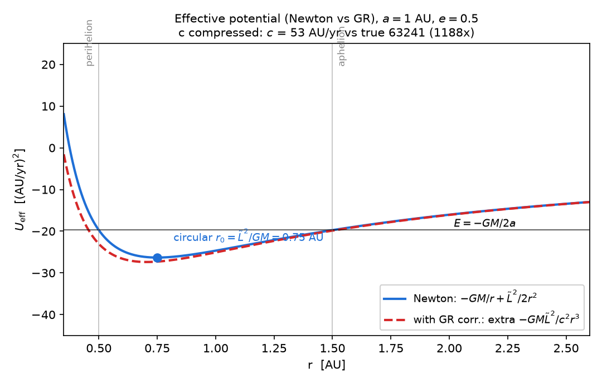
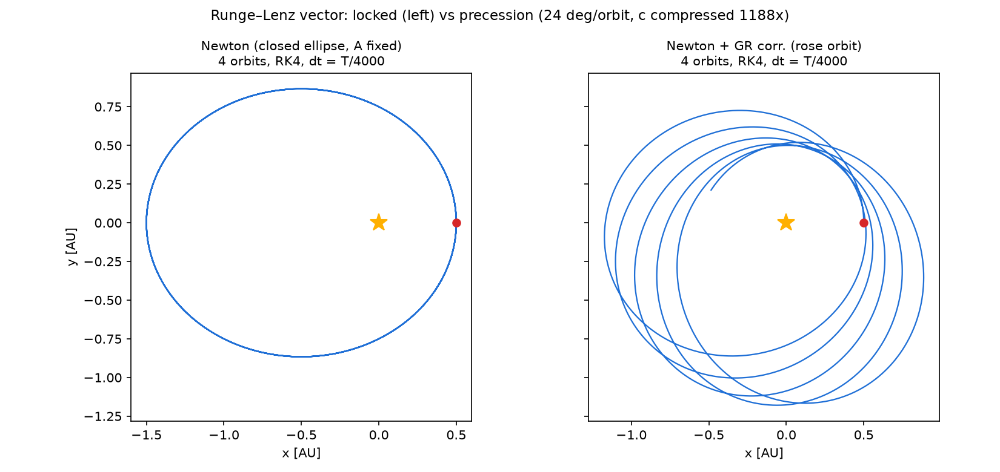

# 天体运动讲义——从第谷的表格到水星的 43 角秒

> **说明**：这是讲义，不是论文——目标是一条线走完"人类如何搞清楚行星运动"的完整推理链：数据→定律→力→轨迹→守恒量→对称性→失效与修正。只用大一数学（微积分+矢量），每个数字给可复算的锚点，两张图可由 `papers/orbit_figs.py`（numpy + matplotlib）复现。本文以 **CC BY 4.0** 授权发布：欢迎转载、改编、翻译、商用，署名即可，详见文末。

## 目录

- 0. 一条 400 年的推理链（含符号表）
- **第一部分 从数据到定律**
  - 1. 第谷的 8 角分：数据如何逼出椭圆
  - 2. 牛顿的逆问题：从 F=ma 反推世界
  - 3. 月球检验与壳层定理
- **第二部分 从定律到轨迹**
  - 4. 有心力通性与有效势（含稳定性判据）
  - 5. Binet 方程：三行解出圆锥曲线
  - 6. 周期只依赖 a：第一个可疑的巧合
- **第三部分 隐藏对称性：隆格–楞次矢量**
  - 7. 定义与一行守恒证明
  - 8. 几何意义与秒推轨道
  - 9. Bertrand 定理与 SO(4)：巧合的消失
- **第四部分 进动：不闭合的轨道**
  - 10. 近心点漂移与微扰 Binet
  - 11. 水星的 43 角秒：大一就能算的广义相对论
  - 12. 进动家族与 Vulcan 的失败
- **第五部分 边界与附录**
  - 13. 两体之后：三体与混沌
  - 14. 为什么是 1/r²、为什么是三维空间
  - 15. 自检清单
  - 16. 附录 A/B/C：两体约化、自检题、授权

---

# 0. 一条 400 年的推理链

这件事的完整链条，比任何单一公式都值得看清：

$$
\text{数据} \xrightarrow{\text{开普勒，8年拟合}} \text{三条经验定律} \xrightarrow{\text{牛顿，倒过来问}} \text{万有引力} \xrightarrow{\text{解方程}} \text{圆锥曲线} \xrightarrow{\text{发现"太好了"}} \text{隐蔽对称性} \xrightarrow{\text{观察"不对了"}} \text{进动} \xrightarrow{\text{算准 43''}} \text{广义相对论}
$$

每一步的驱动力都不是灵光一现，而是**一个无法假装没看见的具体反常**：8 角分的火星偏差、$T^2$ 与 $e$ 无关的巧合、水星不闭合的椭圆。本讲义在每个转折点都会把那个反常摆出来，再看谁、用什么代价把它吃掉。

**符号表（变量住址）**——先消解记号混乱，后文严格照此执行：

| 符号 | 是什么 | 住址/备注 |
|---|---|---|
| $r,\ \varphi$ | 极坐标（原点在力心） | 轨道平面内 |
| $u = 1/r$ | Binet 换元 | 是 $\varphi$ 的函数，$u' = \mathrm{d}u/\mathrm{d}\varphi$ |
| $\mathbf{L}$ | 角动量（$\tilde L = L/m$ 比角动量） | 轴矢量，方向垂直轨道面 |
| $E$ | 机械能（单位质量时记 $\varepsilon$） | 标量 |
| $k$ | 力律常数：$\mathbf{F} = -k\hat{\mathbf r}/r^2$ | 引力 $k = GMm$；量纲 $\mathrm{ML^3T^{-2}}$ |
| $a,\ e,\ p$ | 半长轴、离心率、半通径 | $p = a(1-e^2)$，椭圆情形 |
| $\mathbf{A}$ | 隆格–楞次矢量 | 只对 $1/r^2$ 守恒 |
| $\Delta\varphi$ | 每圈近心点进动量 | 弧度，除非标注角秒 |

单位约定：天文计算取 $[\text{AU}, \text{yr}, M_\odot]$，此时 $GM_\odot = 4\pi^2$（开普勒第三定律的直接翻译），数字干净到可以心算。

---

# 第一部分 从数据到定律

## 1. 第谷的 8 角分：数据如何逼出椭圆

1576–1601 年，第谷·布拉赫在汶岛建造巨型象限仪，把行星位置的测量精度做到约 **1–2 角分**——肉眼观测的物理极限。他积累了 20 年连续、系统、误差已知的火星数据，但没有模型能用。

开普勒接手后的困境是：**地心说 + 匀速圆周**这套两千年的先验框架，与数据的偏差恰好压在第谷误差的 8 倍处——火星黄经最大偏差 **8 角分**。这个量太小，任何诚实的人都可以归咎于误差；又太大，一个知道第谷仪器精度的人无法归咎于误差。开普勒的原话：*“正是这 8 角分，指引我走向天文学的彻底改革。”*

他的取舍值得刻在方法论教科书上：

1. **放弃圆**。先试卵形线失败，再试椭圆——**焦点处放太阳**，与数据吻合到误差内。这不是猜的，是从"面积速度恒定"（第二定律，先于椭圆发现）几何地逼出来的。
2. **三条定律，三条不同的证据线**：椭圆（形状，来自黄经）、等面积（节律，来自速度变化）、$T^2 \propto a^3$（标度，来自不同行星横向比较）。

注意三定律的地位：**它们是描述，不是原因**。为什么是椭圆？为什么焦点上恰好是太阳？为什么面积速度恒定？——经验定律回答了"怎么动"，1609 年的人类对"为什么"一无所知。这就是牛顿的入口。

## 2. 牛顿的逆问题：从 F=ma 反推世界

前人的逻辑方向是：**已知轨道 → 求力**（开普勒定律 → 什么样的力？）。牛顿在《原理》（1687）里做的事是把方向倒过来：**已知力 → 推演一切轨道**。这一倒转，天学从"描述学科"变成"预测学科"。

**第一步：等面积定律 = 有心力。** 牛顿的《原理》命题 1 用"冲量多边形"证明：若物体每过固定时间隔受到一次指向固定点的冲量，多边形对中心扫过的面积逐块相等；令间隔趋于零，即得连续情形。现代一行话：速度增量 $\Delta\mathbf{v} \parallel \mathbf{r}$ 时，$\Delta(\mathbf{r}\times\mathbf{v}) = \mathbf{r}\times\Delta\mathbf{v} = 0$，即 $\mathbf{L}$ 守恒，面积速度 $\mathrm{d}A/\mathrm{d}t = L/2m$ 恒定。**反过来读**：开普勒第二定律成立 ⟺ 力始终指向太阳——这一下把"太阳在中心"从几何假设升级为动力学结论。

**第二步：椭圆 ⟹ $1/r^2$。** 《原理》命题 11 用纯几何（极限三角形 + 椭圆焦点性质）证明：沿椭圆运动、力心在焦点 ⟹ 加速度指向焦点且 $\propto 1/r^2$。几何版较繁，本讲义在 §5 用 Binet 方程给出三行的现代版。同样可证圆轨道匀速 ⟹ $F \propto 1/r^2$（命题 4）。

**第三步：从比例到定律。** 圆轨道上 $F = m\,4\pi^2 r/T^2$，代入开普勒第三定律 $T^2 = C r^3$，得

$$
F = \frac{4\pi^2 m}{C}\cdot\frac{1}{r^2}
$$

其中 $C$ 对**所有行星相同**（第三定律的内容），所以 $4\pi^2/C$ 只依赖于太阳的某种性质——牛顿把它写成 $GM$。再由第三定律对称性（行星也拉太阳），$GM$ 推广为 $G(M+m)$。至此：

$$
\mathbf{F} = -\,\frac{G M m}{r^2}\,\hat{\mathbf r}
$$

**第四步：普适性赌注。** 牛顿宣布这条定律不专属于天体——苹果、月亮、木星卫星、潮汐，一视同仁。这个"普适"才是最大胆的一步：它把亚 Lunar 与超 Lunar 的物理学一次性统一，亚里士多德的天地区域划分就此终结。

## 3. 月球检验与壳层定理

定律写下后必须立刻过两道关，否则只是漂亮的猜想。

**月球检验（1665–66，瘟疫年伍尔索普庄园）。** "把苹果抛到月亮"的地月一致性数值验证：月球轨道半径约 60 个地球半径，按平方反比，月球处的重力加速度应为地表的 $1/60^2 = 1/3600$：

$$
a_{\text{月}} = \frac{4\pi^2 r}{T^2} = \frac{39.478 \times 3.844\times 10^{8}\ \mathrm{m}}{(2.361\times 10^{6}\ \mathrm{s})^2} = 2.72\times 10^{-3}\ \mathrm{m/s^2}, \qquad \frac{g}{3600} = 2.72\times 10^{-3}\ \mathrm{m/s^2}
$$

两条完全独立的路径（测周期+距离 vs 测地表 $g$）在 $1/3600$ 上精确相撞。传说牛顿早年算过一次但差了约 3%——问题出在地球半径的数据不准，后来用 Picard 的新测量值对上，才敢发表。**教训：检验一个 $1/r^2$ 律，你的 $r$ 至少要准到检验的精度。**

**壳层定理（《原理》命题 70–71）。** 真实太阳不是质点。均匀球壳对壳外质点的引力，**精确等于**全部质量集中于球心的质点引力（对壳内则精确为零）。证明用薄壳积分或立体角论证，此处不展开；要点是它的**物理必要性**：

> 若"外部等价于质点"不成立，则开普勒第三定律对真实太阳**根本不可能严格成立**——因为行星轨道半长轴 $a$ 与"到太阳哪个部分的距离"对应都说不清。

壳层定理是平方反比独有的特权（$1/r^3$、$1/r$ 力都没有这个性质），它保证了"点化"合法。牛顿从 1666 年拖到 1687 年才出版《原理》，一个公认的原因就是他迟迟没能自证这条定理——他知道没有它，整座大厦对真实天体是悬空的。

---

# 第二部分 从定律到轨迹

现在进入现代推导路线。约定单位质量化（比角动量 $\tilde L = L/m$、比势 $U=-GM/r$ 不带 $m$），公式更干净；需要质量时乘回去即可。

## 4. 有心力通性与有效势

任意有心力 $\mathbf{F} = F(r)\hat{\mathbf r}$ 下，三件事立刻成立：

1. **平面运动**：$\mathbf{L} = \mathbf{r}\times m\mathbf{v}$ 守恒，故 $\mathbf{r}$ 始终垂直于固定的 $\mathbf{L}$——轨道锁死在一个过力心的平面里。
2. **等面积**：$\mathrm{d}A/\mathrm{d}t = \tilde L/2$（比角动量版），有 $r^2\dot\varphi = \tilde L$。
3. **径向一维化**：能量

$$
E = \frac{1}{2}m\dot r^2 + \underbrace{\frac{L^2}{2mr^2} - \frac{k}{r}}_{U_{\mathrm{eff}}(r)}
$$

把二维问题压成"一维粒子在有效势 $U_{\mathrm{eff}}$ 里运动"——离心势垒 $L^2/2mr^2$ 防止坠落，引力势 $-k/r$ 提供吸引。

**圆轨道与稳定性。** 圆轨道在 $U_{\mathrm{eff}}$ 极小处：$U_{\mathrm{eff}}'(r_0)=0$ 给 $r_0 = L^2/(mk)$。稳定性要求 $U_{\mathrm{eff}}''(r_0) > 0$。对幂律引力 $F = -kr^{\nu}$（$U = kr^{\nu+1}/(\nu+1)$，$\nu\neq -1$），利用圆轨道条件 $kr_0^{\nu} = L^2/(mr_0^3)$ 消去 $k$，得

$$
U_{\mathrm{eff}}''(r_0) = k(3+\nu)\,r_0^{\nu-1} > 0 \iff \nu > -3
$$

**判据 ν > −3**：平方反比（$\nu=-2$）勉强及格（离失稳边界只差 1）；胡克律（$\nu=1$）很稳；$\nu \le -3$（如 $1/r^4$ 独占）则圆轨道失稳，任何微扰使轨道坠落或飞散。这条判据是"我们的宇宙为什么选平方反比"的第一块拼图（§14 展开）。

**图 1**（`orbit_figs.py` 生成）：单位质量有效势。蓝线为纯牛顿 $U_{\mathrm{eff}} = -GM/r + \tilde L^2/2r^2$，极小点即圆轨道 $r_0 = 0.75\ \mathrm{AU}$；红线为加入 GR 修正 $-GM\tilde L^2/(c^2 r^3)$（$c$ 压缩 1188 倍以放大效应）后的曲线——左壁被压低，束缚轨道的往返振荡（径向周期）不再与角向周期同步，这就是进动的势能语言。

## 5. Binet 方程：三行解出圆锥曲线

求轨道形状 $r(\varphi)$，最经济的路径是 Binet 换元 $u = 1/r$。利用 $r^2\dot\varphi = \tilde L$，两个时间导数变成：

$$
\dot r = \frac{\mathrm{d}}{\mathrm{d}\varphi}\!\left(\frac{1}{u}\right)\dot\varphi = -\frac{u'}{u^2}\cdot \tilde L u^2 = -\tilde L\,u', \qquad \ddot r = -\tilde L\,u''\,\dot\varphi = -\tilde L^2 u^2 u''
$$

代入径向方程 $m(\ddot r - r\dot\varphi^2) = F(r)$（注意 $r\dot\varphi^2 = \tilde L^2 u^3$）：

$$
\boxed{\,u'' + u = -\frac{m\,F(1/u)}{L^2 u^2}\,}
$$

这就是 **Binet 方程**（Binet, 1816）。它的价值：把"解二阶时间方程"变成"解 $\varphi$ 的方程"，且右边对幂律力通常退化为简单函数。

**平方反比**：$F = -ku^2$，右边 $= mk/L^2$ 为常数：

$$
u'' + u = \frac{mk}{L^2} \;\Longrightarrow\; u(\varphi) = \frac{mk}{L^2}\big(1 + e\cos\varphi\big) \;\Longrightarrow\; r = \frac{p}{1+e\cos\varphi},\quad p \equiv \frac{L^2}{mk}
$$

通解由"常数特解 + 齐次解 $\cos$/$\sin$"构成，转适当角度消去 $\sin$ 项。轨道是**圆锥曲线**：$e=0$ 圆、$0<e<1$ 椭圆、$e=1$ 抛物线、$e>1$ 双曲线——开普勒椭圆从牛顿定律里**被算出来**，而不是被假设。

**离心率由能量定**：把解代回能量式（或直接用远/近点条件 $\dot r=0$）可得恒等式

$$
e^2 = 1 + \frac{2EL^2}{mk^2}
$$

$E<0$ 椭圆（且 $e<1$）、$E=0$ 抛物线、$E>0$ 双曲线。**能量决定"能不能回来"，角动量决定"跑多扁"**——两个守恒量分工明确。

## 6. 周期只依赖 a：第一个可疑的巧合

椭圆的周期可以用纯几何算出：周期 = 总面积 ÷ 面积速度。

$$
T = \frac{\pi a b}{\tilde L/2} = \frac{2\pi m a b}{L}
$$

代入 $b = a\sqrt{1-e^2}$ 与 $L^2 = mk\,a(1-e^2)$（由 $p = a(1-e^2) = L^2/mk$）：

$$
T = \frac{2\pi m a^2\sqrt{1-e^2}}{\sqrt{mk\,a(1-e^2)}} = 2\pi\sqrt{\frac{m a^3}{k}} \;\xrightarrow{k = GMm}\; T^2 = \frac{4\pi^2 a^3}{GM}
$$

**$e$ 在最后一步之前就消失了**——$\sqrt{1-e^2}$ 上下约掉。于是得到牛顿版开普勒第三定律，且比开普勒版本强得多：

- 对**同一中心天体的所有轨道**（任何 $e$、任何 $m$，只要 $m\ll M$），$T^2/a^3$ 是同一常数，只由 $GM$ 决定。月球、同步卫星、空间站共享同一条标度线（$GM_{\oplus}$），与它们多重、多扁毫无关系。
- 顺带一提：这一步同时解释了为什么壳层定理如此重要（§3）——上式对真实太阳严格成立的前提是太阳可点化。

但请停下来想一想：$e$ 无关其实**很奇怪**。偏心轨道和圆轨道穿越的势能地形完全不同，凭什么周期一样？两个解的"径向往返"与"角向环绕"必须精确同拍——椭圆才闭合。这种"过分的好"通常意味着：**你还没找到全部的守恒量**。这就是第三部分的入口。

---

# 第三部分 隐藏对称性：隆格–楞次矢量

## 7. 定义与一行守恒证明

对 $U = -k/r$，定义

$$
\boxed{\;\mathbf{A} = \mathbf{p}\times\mathbf{L} - mk\,\hat{\mathbf r}\;}
$$

（不同教材差一个 $m$ 或符号，本讲义固定用此式；$\mathbf{A}$ 的量纲 $= \mathrm{M^2L^3T^{-2}} = [mk]$。）

**守恒证明（一行）**：$\dot{\mathbf L}=0$（有心力），$\dot{\mathbf p}=\mathbf F$，且 $\mathrm{d}\hat{\mathbf r}/\mathrm{d}t = \big(\mathbf v - \hat{\mathbf r}(\hat{\mathbf r}\cdot\mathbf v)\big)/r = \mathbf v_\perp/r$，于是

$$
\dot{\mathbf A} = \mathbf F\times\mathbf L - mk\,\frac{\mathrm{d}\hat{\mathbf r}}{\mathrm{d}t},\quad
\mathbf F\times\mathbf L = -\frac{k}{r^2}\,\hat{\mathbf r}\times\big(m\mathbf r\times\mathbf v\big) = -\frac{mk}{r^2}\big[\mathbf r(\hat{\mathbf r}\cdot\mathbf v) - \mathbf v\,r\big] = \frac{mk}{r}\mathbf v_\perp
$$

（末步用了 $\mathbf v - \mathbf v_\parallel = \mathbf v_\perp$。）而 $\mathrm{d}\hat{\mathbf r}/\mathrm{d}t = \mathbf v_\perp/r$，两项恰好相消：

$$
\dot{\mathbf A} = \frac{mk}{r}\mathbf v_\perp - \frac{mk}{r}\mathbf v_\perp = 0
$$

（中间用了 $\hat{\mathbf r}\times(\mathbf r\times\mathbf v) = \mathbf r\,\hat{\mathbf r}\cdot\mathbf v - \mathbf v\,r$，即 BAC–CAB。）$\square$

**它凭什么存在？** 守恒量的数目反映对称性：$\mathbf L$ 对应空间转动对称，$E$ 对应时间平移。$\mathbf A$ 守恒说明 $1/r^2$ 势还藏着一个**不明显的对称**——束缚轨道问题在动力学上具有 SO(4) 对称（比表观的 SO(3) 大一整圈），$\mathbf A$ 就是那 3 个额外守恒荷。数一数：相空间 6 维，守恒量 $\mathbf L$(3) $+ E$(1) $+ \mathbf A$(3) = 7 个，但受 2 个约束 $\mathbf A\cdot\mathbf L = 0$ 与 $A^2 = m^2k^2 + 2mEL^2$（见下），独立 5 个——正好把轨迹完全钉死，这是"所有束缚轨道闭合"的代数原因。

## 8. 几何意义与秒推轨道

**$\mathbf A$ 指向近日点。** 用 $\mathbf A$ 点乘 $\mathbf r$（利用 $(\mathbf p\times\mathbf L)\cdot\mathbf r = \mathbf L\cdot(\mathbf r\times\mathbf p) = L^2$）：

$$
\mathbf A\cdot\mathbf r = L^2 - mkr \;\Longrightarrow\; Ar\cos\theta = L^2 - mkr \;\Longrightarrow\; r = \frac{L^2/(mk)}{1 + (A/mk)\cos\theta}
$$

与标准轨道方程 $r = p/(1+e\cos\theta)$ 逐项对齐，立刻读出全部几何：

$$
e = \frac{A}{mk}, \qquad \text{近日点方向} = \mathbf A \text{ 方向} \;(\theta = 0), \qquad A^2 = m^2k^2 + 2mEL^2
$$

**秒推轨道**：上式就是轨道方程——§5 用 Binet 方程解微分方程得到的结论，这里用一条代数恒等式直接**读**出来，一行微积分都没用。这就是守恒量的威力：守恒量是把运动方程"预先积好分"存起来的地方。

**用法示范**：椭圆近日点速度 $v_p$ 与远日点 $v_a$ 之比。近/远点速度纯切向，面积速度给 $r_p v_p = r_a v_a$，而 $r_{p,a} = a(1\mp e)$，故

$$
\frac{v_p}{v_a} = \frac{1+e}{1-e} \;\xrightarrow{\;e = 0.0167\ (\text{地球})\;} \; 1.034
$$

地球在近日点（1 月初）比远日点（7 月初）快 3.4%——四季不是距离造成的，但轨道速度确实在呼吸。

## 9. Bertrand 定理与 SO(4)：巧合的消失

**Bertrand 定理（1873）**：在所有有心力势中，**只有两种**势的全部束缚轨道闭合：$U \propto -1/r$（椭圆）与 $U \propto r^2$（圆心对称的闭合玫瑰）。其余一切力律的束缚轨道都会进动。

于是"椭圆为什么闭合"的答案分两层：

1. **力学层**：因为 $\mathbf A$ 守恒，近日点方向在空间中锁死，每圈回到同一位置。
2. **对称层**：$\mathbf A$ 守恒等价于 SO(4) 隐蔽对称——闭合性根本不是巧合，是多余对称的表观现象。

**量子版彩蛋**：1926 年 Pauli 不解薛定谔方程，把 $\mathbf A$ 算符化（对易关系恰构成 SO(4) 代数），纯代数地导出氢原子能级 $E_n = -mk^2/2\hbar^2n^2$ 与 $n^2$ 重简并——氢原子能级的"反常简并"（本应依赖角动量 $l$，实际只依赖 $n$）正是 SO(4) 对称的量子回声。你在原子物理里遇到的"意外简并"，和天上椭圆的意外闭合，是同一次巧合的两副面孔。

---

# 第四部分 进动：不闭合的轨道

## 10. 近心点漂移与微扰 Binet

现实世界没有严格 $1/r^2$：行星之间互相拉扯、太阳不圆、时空有曲率。力律一旦偏离，$\mathbf A$ 不再守恒，近日点开始**漂移**——每圈转过角度 $\Delta\varphi \neq 0$，轨道变成缓慢旋转的"玫瑰花环"。

**微扰 Binet 的标准操作**：设引力多出小的额外吸引项 $\beta u^3$（即 $F = -ku^2 - \beta u^3$），Binet 方程变为

$$
u'' + u = \frac{mk}{L^2} + \frac{m\beta}{L^2}u \;\longrightarrow\; u'' + (1-\epsilon)u = \frac{mk}{L^2}, \qquad \epsilon \equiv \frac{m\beta}{L^2} \ll 1
$$

解为 $u \approx \frac{mk}{L^2}\big[1 + e\cos\big(\sqrt{1-\epsilon}\,\varphi\big)\big]$，径向振荡的角频率 $\omega = \sqrt{1-\epsilon} \approx 1 - \epsilon/2$ **变慢**。近心点出现在 $\omega\varphi = 2\pi n$，相邻两近心点的角间隔

$$
\Delta\varphi_{\text{进}} = \frac{2\pi}{\omega} - 2\pi \approx \pi\epsilon = \frac{\pi m\beta}{L^2} > 0
$$

方向判据一句话：**额外吸引 → 近心点顺行（沿运动方向前移）**；轨道"转过头"才回近心点。这张图最直观：

**图 2**（`orbit_figs.py` 生成）：同样初值（$a=1\ \mathrm{AU}$、$e=0.5$）积分 4 圈，RK4、每圈 4000 步。左：纯牛顿——4 圈完美重叠（闭合，$\mathbf A$ 锁死近日点）。右：加入 GR 修正加速度 $\mathbf a_{\mathrm{GR}} = -\,\dfrac{3GM\tilde L^2}{c^2 r^5}\,\mathbf r$（$c$ 压缩 1188 倍）——近心点每圈前移约 $0.41$ rad（$24°$），轨道展开为玫瑰。脚本打印**三链对账**：RK4 空间积分 $+0.4114$ rad/圈、Binet 一维方程独立积分 $+0.4108$（两条独立实现一致到 $6\times10^{-4}$），一阶微扰公式 $6\pi(GM)^2/(c^2\tilde L^2)$ 给 $+0.350$（偏差即光速压缩下的微扰截断）；牛顿侧 4 圈闭合到 $10^{-14}$ AU——$\mathbf A$ 守恒的数值证据。

## 11. 水星的 43 角秒：大一就能算的广义相对论

**观测反常**：1859 年 Le Verrier 用与发现海王星同样的摄动方法处理水星，发现近日点进动的观测值比全部牛顿项（其余行星摄动 + 岁差 + 太阳扁率）多出

$$
\delta = 43.11 \pm 0.45 \ \text{角秒/百年}
$$

（总进动约 $5600''$/百年，牛顿项解释了除这 43″ 之外的一切。）43″ 每百年——即每圈只多 $5\times 10^{-7}$ rad——却顽固地不属于任何牛顿模型。

**GR 修正项**。在史瓦西度规下，Binet 方程多出一项（推导属 GR 课程，此处取结果并给量纲自查）：

$$
u'' + u = \frac{GM}{\tilde L^2} + \frac{3GM}{c^2}u^2
$$

第二项是个 $u^2$ 驱动（来自 $1/r^4$ 型修正力，比 §10 的线性例子高一阶）——把零阶椭圆解 $u_0 = \frac{GM}{\tilde L^2}(1+e\cos\varphi)$ 代入，$u_0^2$ 展开的交叉项 $2e\cos\varphi$ 恰与齐次解 $\cos\varphi$ **共振**，等效于把角向频率稍微拉偏，处理手法与 §10 同构，结果：

$$
\Delta\varphi_{\mathrm{GR}} = \frac{6\pi (GM)^2}{c^2 \tilde L^2} = \frac{6\pi GM}{c^2\,a(1-e^2)} \quad\text{（每圈，用开普勒 } \tilde L^2 = GMa(1-e^2)\text{）}
$$

**水星完整数值**（全部可复算）：$a = 5.791\times 10^{10}\ \mathrm{m}$，$e = 0.2056$，$T = 87.97$ d，$GM_\odot = 1.327\times 10^{20}\ \mathrm{m^3/s^2}$，$c = 2.998\times 10^8\ \mathrm{m/s}$：

$$
\Delta\varphi = \frac{6\pi \times 1.327\times 10^{20}}{8.988\times 10^{16} \times 5.791\times 10^{10}\times(1-0.2056^2)} = \frac{2.50\times 10^{21}}{4.98\times 10^{27}} = 5.0\times 10^{-7}\ \text{rad/圈}
$$

每百年圈数 $= 100\times 365.25/87.97 = 415$ 圈，故每百年

$$
5.0\times 10^{-7} \times 415 \times 206265\ \frac{''}{\text{rad}} = 43''
$$

**与观测残差精确相撞。** 1915 年 11 月，Einstein 算出这个数时发生了心悸（他自己的信件原话）；GR 的第一个定量胜利不是"解释了新现象"，而是**把一个悬置 56 年、所有人都以为属于天体力学的数字收编进理论**。

值得咀嚼的量纲细节：$\Delta\varphi \propto GM/(c^2 a)$ 是无量纲组合，其中 $GM/c^2$ 是**引力半径尺度**（太阳的 $\approx 1.5$ km）。所以 GR 修正是"轨道尺度 $a$ 相对引力半径有多小"的效应——太阳的引力半径只有自身半径的 $2\times 10^{-6}$，这就是为什么修正好不容易才从 43″ 里露头，也是为什么脉冲双星（强场）能把同一效应放大十万倍。

## 12. 进动家族与 Vulcan 的失败

同一套"微扰 Binet + 对账"的框架覆盖一整族现象：

| 系统 | 进动来源 | 量级 | 备注 |
|---|---|---|---|
| 水星 | GR | $43''$/百年 | §11 |
| 水星 | 太阳扁率 $J_2$ | $0.025''$/百年 | 曾被寄望解释 43″，实测 $J_2$ 太小 |
| 月球近地点 | 太阳第三体摄动 | 一圈 8.85 年 | 三体效应，无解析闭式 |
| 脉冲双星 PSR B1913+16 | GR（强场） | $4.23°$/年 | 按每年计放大约 $3.5\times 10^4$ 倍 |
| GNSS / 激光测距卫星 | GR | $\sim 0.5''$/年 | 工程修正项，已进导航软件 |

**Vulcan 的失败**——方法论上与海王星对照的完美案例。Le Verrier 的摄动方法 1846 年发现海王星（预测位置与实测偏差 $<1°$，"笔尖上的行星"），他故技重施把水星残差归因于一颗太阳内侧未知行星，命名为 Vulcan（祝融星），并算出轨道。此后数十年无数日食时刻的搜寻**一无所获**。答案最终是：根本不存在那颗行星，残差属于时间与空间本身。**同样的方法、同样的置信度：一次通向新行星，一次通向新引力理论。** 经验教训：摄动归因是"欠定"的——残差只告诉你"模型缺了点什么"，不告诉你缺的是什么。

---

# 第五部分 边界与附录

## 13. 两体之后：三体与混沌

本讲义的一切闭式结果都只属于**两体**问题（§16 A 给出两体约化）。多一个天体，世界立刻变脸：

- **没有通解**。三体问题的解析解被证明不存在（除特殊轨道族：拉格朗日点、希耳问题的周期解等"孤岛"）。
- **混沌**。Poincaré（1890，奥斯卡二世竞赛论文）在研究三体时发明了"轨道对初值的指数敏感"这一概念——比"混沌"这个词早了 90 年。太阳系本身是弱混沌：行星轨道 Lyapunov 时间约 500 万年，即 1000 万年后的行星位置原则上不可长期预测（尽管百万年内没有实际危险）。
- 这也是为什么天文历表（JPL DE 系列等）本质是**数值积分 + 持续观测修正**，而不是公式。

本站另一篇《一步记忆就够了吗？》讨论的 $h_1$ 混沌判据，正是 Poincaré 这条线的现代延续——天体力学的边界问题至今活着。

## 14. 为什么是 1/r²、为什么是三维空间

两个"为什么偏偏如此"的宇宙学巧合，收尾时值得摆在一起：

1. **平方反比 = 三维空间的高斯定律**。力线从源点向 $4\pi r^2$ 的球面发散，通量守恒自动给出 $F\propto 1/r^2$。换言之，平方反比不是额外假设，是"空间是三维的 + 力线无耗散"的几何必然（静电场同构）。GR 进一步回答"为什么会有引力"：它是时空曲率，$1/r^2$ 只是弱场低速下的近似展开首项。
2. **轨道的稳定性对维数极其挑剔**。$n$ 维空间的高斯定律给 $F\propto 1/r^{n-1}$。用 §4 的判据检查：$n=3$ 时 $\nu = -2 > -3$，稳定；$n=4$ 时 $\nu = -3$，**恰好失稳**（$U_{\mathrm{eff}}$ 的极小消失，任何微扰坠毁或逃逸）；$n>4$ 更糟。所以：

> **稳定行星轨道、稳定原子（经典图像下）都只存在于三维空间。** 若空间是四维的，没有久留的轨道——这是"人择"讨论里最硬的一条物理事实，而且只用本讲义 §4 一页的推导就能证明。

## 15. 自检清单

**推导与计算时：**

- [ ] 有心力问题开工三件事：平面化、等面积（$r^2\dot\varphi = \tilde L$）、有效势——都写了吗？
- [ ] 用 $\mathbf A$ 之前先确认力律**严格**是 $-k/r^2$ 常数 $k$：变质量（吸积）、第三体摄动、GR 修正下 $\mathbf A$ 都不再守恒（GR 下广义化的 A 另有修正版）。
- [ ] 进动方向检查：额外**吸引** → 顺行；使引力"变软"的修正 → 退行。
- [ ] 涉及 GR 修正时，修正项是 $3GMu^2/c^2$（Binet 语言），不要手滑写成对势随便加 $1/r^3$。
- [ ] 所有 $r$、$a$ 用国际单位还是天文单位？混用是本领域数值第一大坑（月球检验的 3% 教训）。

**拿到结果后：**

- [ ] 极限行为：$e\to 0$ 还原圆轨道？$e\to 1$ 呢？$\Delta\varphi$ 在 $c\to\infty$ 时归零吗？
- [ ] 量纲：$\Delta\varphi_{\mathrm{GR}} = 6\pi GM/(c^2 a(1-e^2))$ 是无量纲组合吗？（是——自查一遍）
- [ ] 数量级：太阳引力半径 $GM_\odot/c^2 \approx 1.5$ km，任何"GR 修正"都该是 $\sim 10^{-6}$ 量级起步再除以别的——43″/百年符合这个"贫困"吗？（符合）
- [ ] 有没有第二条独立链对账？（本讲义的月球检验、水星 43″ 都是双链相撞的范例）

## 16. 附录

### A. 两体问题的一句话约化

两个天体 $m_1, m_2$ 在相互引力下运动，位置分解为质心 $\mathbf R$（匀速直线，动量守恒）与相对位矢 $\mathbf r$。相对运动满足

$$
\mu\,\ddot{\mathbf r} = -\,\frac{G m_1 m_2}{r^2}\hat{\mathbf r}, \qquad \mu = \frac{m_1 m_2}{m_1+m_2}
$$

即"质量换成约化质量 $\mu$、$k$ 换成 $Gm_1m_2$ 的单体问题"。本讲义全部公式经此替换后对双星严格适用（$\tilde L$、$E$ 亦按 $\mu$ 理解）；$m\ll M$ 时 $\mu\to m$，退化为行星绕固定太阳。开普勒第三定律的牛顿精确版是 $T^2 = 4\pi^2 a^3/G(M+m)$——对木星卫星，$m$ 不可忽略，这个修正项本身就能用来"称"木星质量。

### B. 自检题（点击展开答案）

**B1.** 用 Binet 方程判断：力律 $F = -k/r^2$ 换成 $F = -k/r$（与 $r$ 成正比的吸引，即二维"弹簧"宇宙），轨道还闭合吗？

答案

不闭合。$F = -ku = -k(1/u)^{-1}$……直接代 Binet：$F(1/u) = -k\,u^{-1}$（$u = 1/r$，力 $\propto r = 1/u$），右端 $= mk/(L^2 u^3)$，方程 $u'' + u = \dfrac{mk}{L^2u^3}$ 非线性，通解不是简谐，$\omega$ 依赖振幅 → 各圈周期不一 → 进动。这也正是 Bertrand 定理的另一成员的排除法写法：胡克律 $F\propto -r$ 闭合是另一回事（其轨道是以**力心为几何中心**的椭圆），$1/r$ 力不在 Bertrand 名单里。

**B2.** 地球轨道 $e = 0.0167$。分别用（a）面积速度、（b）能量守恒，求近日点与远日点的速度比，并说明两法必给同一答案的原因。

答案

(a) $r_pv_p = r_av_a \Rightarrow v_p/v_a = r_a/r_p = (1+e)/(1-e) = 1.034$。(b) vis-viva 公式 $v^2 = GM(2/r - 1/a)$ 分别用在近/远点，两式相除同样得 $1.034$。原因：两条路用的守恒量（$\tilde L$ 与 $E$）是同一轨道的两组独立积分，轨道方程保证了它们相容；若两法结果不同，说明某条守恒律在计算中被破坏——这是数值程序调试时最好的交叉验证。

**B3.** 用 $\mathbf A$ 证明：同一 $E$、$\tilde L$ 的轨道，$\mathbf A$ 的模长唯一确定离心率；再解释为什么由此立刻得出"束缚轨道闭合"。

答案

$e = A/mk$，其中 $A^2 = m^2k^2 + 2mEL^2$ 只含守恒量 → 沿轨道 $A$、方向均不变 → 轨道方程 $r = (L^2/mk)/(1+e\cos(\theta - \theta_0))$ 中 $\theta_0$ 固定 → $r(\varphi)$ 以 $2\pi$ 为周期重复 → 闭合。逻辑链：守恒性（动力学）→ 方向固定（几何）→ 周期性（闭 合）。

**B4.** 只用 $\Delta\varphi_{\mathrm{GR}} = 6\pi GM/(c^2a(1-e^2))$，估算地球轨道的 GR 进动（角秒/百年），并与水星的 43″ 对照说明差异主因。

答案

先算每圈：$a_\oplus = 1.496\times 10^{11}$ m，$e = 0.0167$。$\Delta\varphi = 6\pi GM/(c^2 a(1-e^2)) = 6\pi\times1.327\times10^{20}/(8.988\times10^{16}\times1.496\times10^{11}) = 1.86\times10^{-7}$ rad/圈。地球每年恰 1 圈 → 百年 $1.86\times10^{-5}$ rad $= 3.8''$/百年。

**对账（因子分解）**：水星/地球比值应等于三个独立因子之积——半长轴因子 $a_\oplus/a_{\text{水}} = 1.496/0.555 = 2.70$（因为 $\Delta\varphi\propto 1/[a(1-e^2)]$，$e$ 的贡献在两者都接近 1，仅占 $\sim 4\%$）、圈数因子 $415/100 = 4.15$、其余因子相同。$2.70\times4.15 = 11.2$，而 $43/3.8 = 11.3$ ✓ 两条链相撞，计算自洽。

**结论**：地球 GR 进动约 $3.8''$/百年，水星大约 11 倍——主因是水星的 $a$ 小（引力半径 $GM/c^2\approx1.5$ km 占轨道尺度的比例大）加上每年圈数多 4 倍。

**B5.** 为什么壳层定理只对平方反比成立？给一个不成立时的定性后果。

答案

高斯型论证：对 $F\propto 1/r^2$，从对称球壳取的任意一对对面体元对壳外点的贡献比恰由距离平方抵消面积增长，总贡献严格等价于中心质点；对其他幂律，"距离变远"与"贡献衰减"不再互相抵消。后果：若太阳不能点化，行星感受到的力随其是否靠近"太阳表面"而变化，开普勒第三定律的 $T^2\propto a^3$ 只能近似成立，且不同行星的"有效太阳质量"随轨道深度漂移——牛顿版第三定律 $T^2 = 4\pi^2a^3/GM$ 的普适常数性质崩塌。

**B6.** 脉冲双星 PSR B1913+16：$P_b = 7.75$ h，$e = 0.617$，$a\sin i \approx 7.0\times 10^9$ m 量级（取 $a \approx 1.2\times 10^9$ m 作为量级估计）。用 §11 公式估算其 GR 近心点进动，并与 $4.2°$/年 对照。

答案

射电到达时间给出脉冲星轨道投影半长轴 $a_p\sin i \approx 7.0\times 10^8$ m；结合质量比（$m_p\approx m_c\approx1.4\,M_\odot$）与轨道倾角解出总间距 $a \approx 1.95\times10^9$ m。取 $GM \approx 2.83\,M_\odot \approx 3.75\times10^{20}$ m³/s²，$1-e^2 = 0.619$：

$$
\Delta\varphi = \frac{6\pi GM}{c^2a(1-e^2)} = \frac{6\pi\times3.75\times10^{20}}{8.988\times10^{16}\times1.95\times10^9\times0.619} = 6.5\times10^{-5}\ \text{rad/圈}
$$

每年圈数 $= 8766/7.75 = 1131$，故每年 $6.5\times10^{-5}\times1131 = 7.3\times10^{-2}$ rad $= 4.2°$——与观测 $4.23°$/年 相撞。**要点**：强场（$GM$ 大 2.8 倍）+ 短周期（每年圈数多 273 倍）+ 高离心率，三个因子把水星的"每百年几十角秒"放大成射电天文学里直接可测的主效应；Hulse–Taylor 双脉冲星正是以此（加上轨道能量因引力波辐射的对账）拿下 1993 年诺贝尔奖。

**B7.** 概念题： $\mathbf A$ 守恒与"SO(4) 对称"是什么关系？为什么说"闭合性是表观现象"？

答案

每一条守恒律对应一个连续对称性（Noether）。$\mathbf L$ 守恒 ⟺ SO(3) 空间转动对称（表观：势是球对称的）。$\mathbf A$ 守恒 ⟺ 一个不在坐标里直观显现的额外对称——把束缚轨道问题映射到四维旋转球面上的"SO(4) 对称"。因为对称群比 SO(3) 大，守恒量比"能量+角动量"多，简并/闭合这类"过分的好"自动出现。"表观"指：你不需要知道 SO(4) 也能算轨道，但它才是闭合性的**原因**——就像冰山露出水面的部分是表观，水下体积才是原因。

**B8.** 陷阱题：某同学把 GR 修正记成"势能多加一项 $-GM\tilde L^2/(c^2r^3)$"，然后用纯牛顿的 $\mathbf A$ 矢量去推轨道，声称近日点应固定。错在哪里？

答案

两处。其一，加了对势之后力律不再是严格 $-k/r^2$（多了 $-3GM\tilde L^2/(c^2r^4)$ 型吸引项），$\mathbf A$ **不再守恒**——它的导数 $\dot{\mathbf A} = -\beta(\cdots)\neq 0$，近日点方向随时间漂移，这恰是进动的矢量语言（§10）。其二，逻辑上不能"用旧守恒量研究新力律"：守恒量是力律的函数，力律变了，守恒集合整个要重新清点（GR 下对应的是广义化的 Laplace–Runge–Lenz 矢量，含度规修正项）。教训：**每个守恒量都只属于特定的力律**，换力律先换守恒量清单。

### C. 授权

本文以 [CC BY 4.0](https://creativecommons.org/licenses/by/4.0/) 授权发布：你可以自由地**转载、改编、翻译、商用**，只需署名并注明来源。配套数值脚本 `papers/orbit_figs.py` 同样开放，欢迎 fork 改参数做自己的实验。
